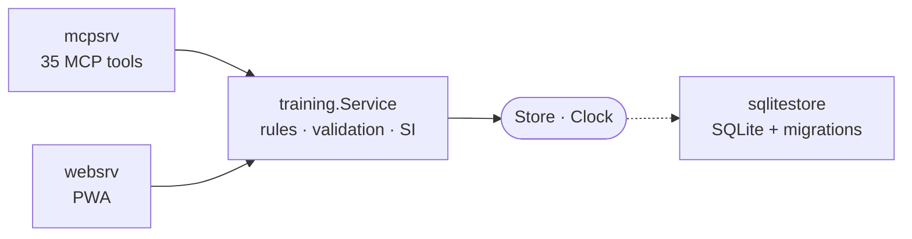

<p align="center"></p>

# Training MCP

[](https://github.com/FullFran/training-mcp/actions/workflows/ci.yml)
[](go.mod)
[](LICENSE)

**Your training log, connected to your AI assistant.** Training MCP is a
self-hosted workout tracker built with Go and SQLite. Record sets in conversation
through MCP, or use the optional installable web app between sets at the gym.

```text
You: "Tres series de ocho en press banca a 80 kg, RPE 8"
Assistant: logs the sets in today's training session
```

[Get started](#quick-start) · [ChatGPT setup](docs/chatgpt-setup.md) ·
[Connection and authentication](docs/connection-paths.md) ·
[Tool reference](docs/tools.md) · [Architecture](docs/architecture.md)

## What you can do

- **Log naturally:** record sets, weight, reps and RPE with an MCP client.
- **Train from your phone:** use the optional PWA for plans, set logging and a rest timer.
- **See your progress:** review training history, estimated records and volume.
- **Bring your history:** import a Hevy or Strong CSV export from the PWA, with a
  preview first; importing the same file twice adds nothing.
- **Keep your data:** the service stores workouts in SQLite; export and backup
  options are described below.

The MCP server uses Streamable HTTP. A compatible client needs network access
and appropriate authentication; ChatGPT setup requires a public HTTPS endpoint.
The PWA is disabled by default. **Its current authentication relies on a secret
URL and a reverse proxy:** anyone who gets that URL has full access. Read
[connection paths](docs/connection-paths.md) and [Web UI](#web-ui-pwa) before
making the service accessible to others.

## Quick start

Requires Go 1.26 or newer and a terminal with `openssl` and `curl`.

```sh
git clone https://github.com/FullFran/training-mcp.git
cd training-mcp
export MCP_BEARER_TOKEN="$(openssl rand -hex 32)"
go run ./cmd/training-mcp --addr 127.0.0.1:8080
```

In another terminal, check that the local service is running:

```sh
curl http://127.0.0.1:8080/health
# {"status":"ok"}
# or using the healthcheck subcommand (exit 0 if healthy, 1 on failure):
go run ./cmd/training-mcp healthcheck --addr 127.0.0.1:8080
```

This checks the server, not an MCP client connection. Keep the token private;
a new random token is generated each time you run the export command. For
persistent configuration, set a stable token outside source control.
To connect an MCP client or ChatGPT, follow
[connection paths](docs/connection-paths.md) and
[ChatGPT setup](docs/chatgpt-setup.md). Public access requires HTTPS.

## Why it is built this way

The same workout gets logged two ways — talking to ChatGPT on the sofa, tapping
a phone between sets — and both must apply **identical** rules. Same validation,
same exercise normalization, same SI arithmetic. So the rules live in one
domain package and both interfaces are adapters over it:



`training` imports no adapter. That is what makes it testable without a
database, and what makes the two front ends provably unable to disagree about
what a set is worth.

Full write-up: **[docs/architecture.md](docs/architecture.md)**.

## What is worth a look

| | |
|---|---|
| **Ports and adapters, honestly applied** | The dependency arrow only points inwards. [architecture](docs/architecture.md) |
| **`Clock` as a function type** | One method, so `time.Now` satisfies it directly. No mock framework in the repo — tests pass a closure. |
| **Prescription copying** | Starting a session from a plan copies it. Editing a template never rewrites history; adjusting today never edits the template. |
| **Totals recalculated, never incremented** | A deleted or edited set cannot leave a session total wrong. |
| **Advisory, never automatic** | `suggest_load`, `volume_recommendation` and `performance_dropoff` explain themselves and decline when they lack evidence. None ever edits a plan. |
| **Config absence removes surface** | Without `WEB_OAUTH_CLIENT_ID` the PWA is not mounted at all, rather than served without a login. |

## Development checks

Run `go test ./...` and `go vet ./...`. CI also checks formatting, the race
detector and a coverage floor for the SQLite store, and builds and boots the
Docker image the way the server does. Merging to `main` deploys; see
[deployment](docs/deployment.md).

## Configuration

| Variable/flag | Default | Purpose |
|---|---|---|
| `--addr` | `:8080` | HTTP listen address |
| `TRAINING_DB_PATH` | `~/.local/share/training-mcp/training.db` | SQLite file |
| `MCP_BEARER_TOKEN` | required | Static bearer credential |
| `MCP_AUTH_DISABLED=1` | disabled | Unsafe tunnel-only development bypass; never use in production |
| `MCP_OAUTH_ISSUER`, `MCP_OAUTH_RESOURCE`, `MCP_OAUTH_SUBJECT` | off | Also accept OAuth access tokens on `/mcp`; set all three or none, see [connection paths](docs/connection-paths.md) |
| `MCP_OAUTH_PROVISION` | off | `1` gives any subject the OAuth provider vouches for an account of its own; off, only the owner and existing accounts get in |
| `WEB_BASE_PATH` | ignored | Retired. It used to serve the PWA under a secret prefix; the PWA is now only served at the root behind the login. If still set, the server says so at startup and otherwise ignores it |
| `WEB_OAUTH_CLIENT_ID`, `WEB_OAUTH_CLIENT_SECRET` | off | The provider's OAuth application for the web login; set both, with the `MCP_OAUTH_*` settings, to serve the PWA at the root behind a login, see [connection paths](docs/connection-paths.md) |
| `TRAINING_COACH`, `TRAINING_COACH_KEY` | off | `1` and a 32-byte base64 key turn on the in-app coach, which chats with each person's own ChatGPT account; experimental, see [in-app coach](docs/coach.md) |

The unauthenticated `GET /health` endpoint returns `{"status":"ok"}`. Alternatively, `training-mcp healthcheck` sends `GET /health` to the local listener (defaulting to port 8080 or derived from `--addr`) and exits 0 on HTTP 200 or 1 on failure, designed for distroless container healthchecks without a shell, `curl`, or `wget`. MCP is only available at `/mcp` for GET, POST, and DELETE. Public ChatGPT access requires HTTPS at the TLS termination boundary.

## Tools

35 tools, grouped by what you are doing: logging sets, managing plans,
adjusting today's session, progression and analysis, the feedback loop, and the
exercise catalogue.

**Full reference: [docs/tools.md](docs/tools.md)** — every tool with the
description the model actually receives, extracted from the source so it cannot
drift, followed by the design notes explaining why the surface looks like this.

A few shapes worth knowing before reading it:

- Every write tool is a proposal. Its result says `status: accepted` (applied),
  `pending` (waiting on the `/review` page or the coach chat) or `rejected`,
  plus a `proposal_id`. Answers follow HCS-0005: allow or reject once, or
  always for that action type in this session only (one coach conversation,
  or 12 hours for external MCP clients). Each account has an approval mode:
  `review_all` asks for everything, `accept_except_delete` applies every write
  except deletes, and `accept_all` applies everything. New accounts start in
  `accept_except_delete`; existing accounts keep what they had (migration 027).
  See [Every write is a proposal](docs/tools.md#every-write-is-a-proposal).

- `log_set` needs no session id. It finds or creates today's session, so
  conversational logging is one call. The explicit `start_session` + `add_set`
  path remains for when you want control.
- Load is never planned. A prescription is sets, reps and RPE; the weight that
  meets it is discovered at the gym.
- A set can carry an intensity technique (drop set, rest-pause, myo-reps). It
  is a property of the set, not a separate exercise, so volume still counts
  toward the right muscle group while a technique set never becomes the
  exercise's record.
- Every exercise maps to exactly one muscle group, so group SI is a true
  partition of session SI. Unmapped exercises are reported under an empty
  group rather than dropped, keeping catalogue gaps visible.

## Web UI (PWA)

Setting `WEB_OAUTH_CLIENT_ID` and `WEB_OAUTH_CLIENT_SECRET` (with the
`MCP_OAUTH_*` settings) serves an installable PWA for logging sets from a phone
without going through ChatGPT. It is a driving adapter over the same
`training.Service`, so validation, exercise normalization and SI calculation are
shared with the MCP tools and cannot drift apart.

- Served at the root to whoever signs in with the OAuth provider, each seeing
  only their own data. That login is its only entrance: no bearer token opens
  it. Without those settings it is not served at all. It never serves the
  database export, which holds every user's data.
- The home offers two modes. **Entrenar** is a training logger: start a plan
  or an empty session (while one runs, **Cambiar de rutina** under
  **Continuar** offers the other routines: with nothing logged the choice
  replaces it, with sets logged they stay and its exercises are added), then
  each exercise is a card with its set table
  (Serie, Anterior, kg, Reps, RPE), pre-filled from the plan, the set before
  and last session; tapping a row's number marks it as a warm-up (an amber
  **W** that never counts); one check logs a set and starts the rest timer, supersets
  keep their round rest, and **Terminar** shows the day's summary; with the
  coach on, **Comentar con el coach** there opens a new Planificar conversation
  with a message about that session typed in, ready to send. Changes
  made during the workout (sets, rep range, RPE, skip, swap, add, remove) edit
  today's session only; the routine stays a template. **Cancelar entreno**, at
  the end of the workout, deletes today's session (the same call as
  `delete_session`) and returns to Entrenar to choose any routine; with sets
  logged it asks first and says how many sets go. A bar at
  the bottom opens the coach (when `TRAINING_COACH=1`, see
  [docs/coach.md](docs/coach.md)) as a sheet over the workout that closes back
  to the same point; when an answer gives a load («45 kg × 8») an **Aplicar**
  chip writes it into the set row, which the person still logs with its check.
  **Planificar** is the coach's chat on the whole screen, with its
  conversations behind ☰ and the chips Coach, Rutinas, Revisión and Memoria;
  the plan of the day, pending proposals (a routine the coach proposes is a
  draft to **Revisar y guardar**), what was applied in the last 12 hours
  (**Deshacer**) and logged sets appear there as cards rendered by the
  server. The screen is kept in the URL (`/?modo=entrenar`, `/?modo=planificar`,
  `/?modo=progreso`, `/?modo=tu`).
- **Progreso** has three views. **Historial**: this week's training days as
  dots with the sessions and kilos moved, then every session by month; each
  opens its detail, where **Guardar como rutina** turns it into a routine
  (the same call as `save_session_as_plan`: adjustments and off-plan work
  kept, skipped exercises left out) and **Borrar sesión** deletes it with
  every set in it (the same call as `delete_session`); **Editar series** opens
  plain forms to add, correct and delete its sets. **Añadir sesión pasada**
  creates a session on an earlier date, optionally following a routine (the
  same call as `start_session`), and opens it there for its sets; today and
  later dates are refused, so it never becomes today's workout. **Ejercicios**: every exercise with its best e1RM, best set
  and a sparkline of the best e1RM per session, plus next week's volume advice,
  volume per muscle group, and **Series por semana**: working sets and SI per
  muscle group for the last four Monday-to-Sunday weeks (the call
  `weekly_volume` makes); each exercise opens a detail with the chart, the best
  sets, the fatigue between sets last time and every session's sets.
  **Cuerpo**: body weight and measurements are not recorded yet, and it says so.
  The old `/history` URL redirects here.
- **Tú** holds the profile and the coach's memory, connectors, model, account
  and conversations (kept 90 days), **Ejercicios** (every exercise with its
  muscle group and setup note, editable: the calls `set_exercise_group` and
  `set_exercise_note` make), **Límites de volumen** (each muscle group's MEV
  and MRV in weekly sets, the call `set_volume_landmarks` makes; next week's
  advice never crosses them), the default rest between sets, **Unidades**
  (kg or lb, per person; see below), and the data: import from Hevy or Strong
  and the database export.
- **Units.** Every weight is stored in kg, as before. Each person chooses a
  default unit in Tú (kg until chosen, migration 026 `users.weight_unit`), and
  every weight the app shows is in it: the workout, the finish summary, a
  session's page, Progreso, the picker, proposals and chat cards. Every weight
  input (a set row, the entry form, the edit of a logged set) has a **kg/lb**
  toggle starting on the default; it changes the unit of the number typed,
  never the number, and the server stores kg. lb shows to 0.1 lb, and a value
  typed in lb is stored as the roundest kg that shows as the same number, so
  a load shown and saved again never drifts (60 kg shows as 132.3 lb and saves
  back as 60 kg). An edit that leaves the weight as shown does not resend it.
  Load advice steps a plate: 2.5 kg or 5 lb. A form without a unit is kg, as
  every client before units sent. Strong's import assumes the person's unit.
  **Corregir pesos en lb** (Tú › Datos, or a session's page) fixes past sets
  typed in lb but stored as kg: choose a session, or an exercise between two
  dates, see every set with its stored kg now and after, untick any, and
  confirm. Each ticked number is read as lb and stored in kg; a corrected set
  is marked and never converted twice; it is recorded in the history and can
  be undone (the same undo as accepted proposals). The agent has the same as
  `preview_lb_correction` and the proposal-gated `correct_lb_sets`; every MCP
  weight stays in kg.
- **+ Añadir ejercicio** and **Sustituir** in the workout open an exercise
  picker: search (accents ignored), recent exercises, filters by muscle group,
  each with its last set; several can be added at once, and a name that does
  not exist yet can be created. **Superserie y notas**, collapsed under the
  list, sends the optional superset label and notes `add_session_exercise`
  takes. While adding, one **Sugerido por el coach** row
  comes first, worked out from stored data with no model call: the muscle
  group the volume recommendation raises most, else the one with the fewest
  working sets this week, and that group's most recently logged exercise not
  already in today's session.
- `/review` lists the agent's pending proposals with what each would change
  (one sentence per write tool, the exact payload one tap away),
  accepts or rejects them (once, or always in that session), shows the answer history
  and holds the approval mode selector. The person's own changes in the app apply
  directly.
- A plan can be started for the day; its exercises become the cards of
  Entrenar, each showing done/target sets.
- The day's plan is fully adjustable mid-session: add or drop an exercise,
  change its set count, skip it, or substitute it when a machine is taken.
  Sets already logged are never touched by any of this — an exercise removed
  from the plan simply reappears as off-plan work.
- `/import` (linked from Tú) imports a Hevy or Strong workout
  CSV: a preview of sessions, sets, exercise names to map and duplicates first,
  then one all-or-nothing import on confirmation. See [docs/import.md](docs/import.md).
- Sets are grouped by exercise, the way a workout is performed and read back.
- The entry form shows what was done last time for that exercise and the
  standing estimated-1RM record; a set matching the record is badged `PR`.
- The exercise field autocompletes from every exercise already known, which is
  what stops the catalogue fragmenting into near-duplicate names.
- Quick-pick chips restore the last weight, reps and RPE per exercise.
- Session feedback asks only about the muscle groups actually trained that day.
- Superset members are marked in the checklist; after logging one, the next
  movement of the round loads immediately and the rest timer is held back
  until the round is finished.
- An exercise's setup note is shown whenever that exercise is selected.
- `/plans` builds and edits routines from the phone: rename, add, reorder and
  remove exercises, and write the routine's notes. It is a separate screen
  because planning is deliberate work, not something done between sets.
  **Crear a mano** there, and **Crear rutina a mano** in Entrenar's empty
  state, open `/plans?nueva=1`: the name alone, focused; **Crear y añadir
  ejercicios** lands on that routine's own editor (`/plans?rutina=ID`) with
  the exercise field focused. A routine starts with a placeholder exercise
  (a plan needs one), hidden in the editor and dropped when the first real
  exercise is added.
- A rest timer starts when a new set is logged, counts from when the server
  stored it (so a reload resumes it) and shows the exercise planned next. Its
  ±30 s buttons change the rest target the agent also reads (`live_workout`).
  In ChatGPT, Claude and other chats that support MCP Apps, `render_rest_timer`
  shows the same rest as an interactive countdown in the conversation
  ([MCP Apps](docs/apps.md)).
- Every in-session change the MCP offers is on the workout screen: add an
  exercise to today's plan, change its sets, rep range or RPE, skip, swap or
  remove it, and edit or delete a logged set, including its exercise.
- Sets can be edited in place instead of deleted and re-entered.
- Today's session is created lazily on the first set, so opening the app never
  leaves an empty session behind.
- The service worker caches the shell and the last viewed pages for offline
  *reading*. Writes always require the network — a set only counts once stored.
- The worker's cache version is a hash of the static files and the worker
  itself, computed at startup, so it is never bumped by hand: any change to them
  makes browsers install a new worker and refetch the shell, and an unchanged
  build keeps the installed one. Static files are served `no-cache` with an
  ETag, so a browser revalidates them instead of keeping a copy for a week.

`scripts/backup.sh` takes a consistent snapshot of the whole database straight
from the Docker volume that holds it, with `VACUUM INTO`, so it is safe while the
server is running. It runs on the host that runs the server and requires
`.credentials/volume.env` naming the volume (`DB_VOLUME=training-mcp-data`):
without that file the run fails and notifies, and there is no other source. The result is a plain
SQLite file: **restoring is copying it back into the data volume.** The script
verifies it opens and passes an integrity check, and keeps the last 30 daily
copies. A failed run keeps the existing copy
and raises a desktop notification.
`scripts/install-backup-cron.sh` schedules it hourly with `--daily`, which stops
after the day's first success, so a machine that was off at one hour still gets
its copy — a backup you have to remember to take is not a backup.

With `.credentials/r2.env` present, each daily copy is also encrypted with `gpg`
and uploaded to Cloudflare R2, so the bucket only ever holds ciphertext. A failed
upload notifies and retries on the next run that day; the next day's copy is a full snapshot either way. The file needs `R2_ENDPOINT`,
`R2_BUCKET`, `R2_ACCESS_KEY_ID`, `R2_SECRET_ACCESS_KEY` and `BACKUP_PASSPHRASE`,
as `NAME=value` lines taken literally, with no quotes.
Keep the passphrase somewhere other than this machine: without it the copies
cannot be read. Expire old objects with a lifecycle rule on the bucket.

The off-site run lives on the VPS, in `~/training-mcp-backup`: `scripts/backup.sh`,
`scripts/r2-env.sh` and `scripts/restore-check.sh`, plus `.credentials/r2.env` and
`.credentials/volume.env`. The snapshot runs in a throwaway container with no
network, as the database file's owner, so it needs no web route; `volume.env` may
also set `DB_FILE` (default `training.db`) and `SNAPSHOT_IMAGE` (default a pinned
`python:3.13-alpine`). It needs `curl`, `gpg`, `sqlite3`
and `docker`, and cron runs it with `/bin/bash` hourly with `--daily`. On the VPS a
failure only reaches `~/.local/state/training-mcp/backup.log`, as there is no
desktop to notify. The VPS is the only uploader. The bucket expires objects after 90 days by age
alone, so a long silent failure would empty it. There is no Go on the VPS, so run
`restore-check.sh --no-boot` there.

`scripts/check-offsite.sh` covers that silence from outside: the
`Off-site backup check` workflow runs it daily with a read-only token, and fails if
the newest object is older than yesterday or the bucket cannot be read, which also
catches a dead VPS or a revoked token. GitHub emails the failure. It needs the
repository secrets `R2_ENDPOINT`, `R2_BUCKET`, `R2_WATCH_ACCESS_KEY_ID` and
`R2_WATCH_SECRET_ACCESS_KEY`. GitHub disables scheduled workflows after 60 days
without repository activity, and they then need re-enabling.

No automation runs on the owner's laptop. `.credentials/r2-watch.env` stays there
as its copy of `BACKUP_PASSPHRASE`, and running `check-offsite.sh` by hand reads it.

`scripts/restore-check.sh` proves a copy is restorable without touching
production: it fetches the newest object, decrypts and verifies it, boots the
server on it in a temp dir, and reads it back through MCP. Run it after setting
this up and periodically afterwards. To really restore: decrypt with
`gpg --decrypt`, stop the app, copy the file into the `/data` volume as
`training.db`, and start the app again.

**Authentication is currently the secret URL itself.** The reverse proxy injects
the bearer token, so anyone holding the URL has full access. This is tracked
debt, not a design: see the open issues.

## Scope and limitations

- MCP supports a static bearer token and optional OAuth token verification.
  OAuth issuance is handled by an external provider. See
  [connection paths](docs/connection-paths.md) for account provisioning and
  its security implications.
- The optional PWA currently uses a secret URL and a reverse proxy that injects
  the bearer token. Treat the URL as a credential.
- Recommendations are advisory: they do not change a plan automatically.
- PWA offline caching is for reading; recording sets requires a network connection.
- This project does not provide a general REST/GraphQL API or an audit history.

## Documentation

- [Architecture](docs/architecture.md) — ports and adapters, package layout, testing
- [MCP tool reference](docs/tools.md) — all 35 tools
- [ChatGPT setup](docs/chatgpt-setup.md)
- [Connection paths and tunnel safety](docs/connection-paths.md)
- [SI formula](docs/si-formula.md)
- [Importing from Hevy and Strong](docs/import.md) — formats, name mapping, duplicates, limits
- [In-app coach](docs/coach.md) — chat with your own ChatGPT while you train, and connect your own remote MCP servers (Notion and others) to it; off by default, experimental
- [Deployment](docs/deployment.md) — how `main` reaches production, CI gate, rollback

The external Secure MCP Tunnel smoke flow is **unverified in this repository**. Use the official provider documentation rather than invented commands.
