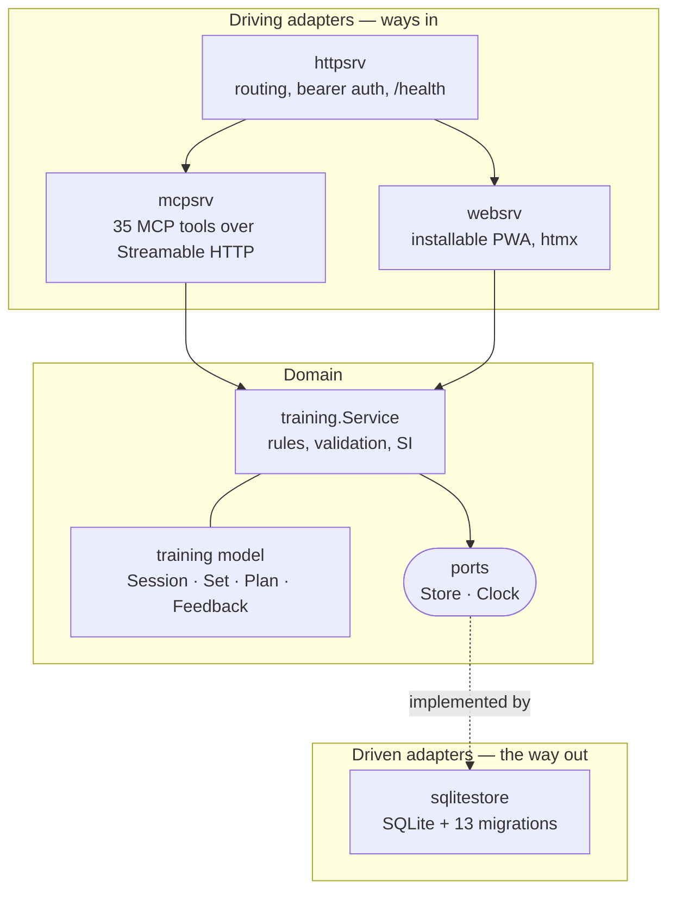

# Architecture

Training MCP is a hexagonal (ports and adapters) Go service. One domain, one
service, several ways in, one way out.

The shape exists for a concrete reason: the same workout can be logged by
talking to ChatGPT, or by tapping a phone between sets. Those are two very
different interfaces onto **identical** rules — the same validation, the same
exercise normalization, the same SI arithmetic. Duplicating that logic per
interface is how two front ends silently start disagreeing about what a set is
worth.



## The two ports

The domain declares what it needs and nothing more.

```go
// internal/training/store.go
type Store interface {
	ForUser(userID int64) UserStore
	Snapshot(context.Context, string) error // the whole database, for backup
}
type UserStore interface { /* 36 methods, all context-first */ }

// internal/training/model.go
type Clock func() time.Time
```

`Clock` being a function type rather than an interface is deliberate: it has one
method, and `time.Now` satisfies it with no adapter at all. Wiring in
`main.go` reads `training.NewServices(store, time.Now)`, and a test pins the date
by passing a closure. There is no mock framework anywhere in this repository.

`Store` is split so a data method cannot be called, nor compile, without saying
whose data it is. `UserStore` holds the user id itself, with no default user, and
every statement filters by it. Child rows (`sets`, `plan_items`, `session_items`,
`session_feedback`) are reached through a parent the user owns. Another user's id
behaves exactly like a missing id, with the same error, so its existence cannot be
inferred. A `training.Service` is built on one `UserStore`, so it serves one user.
`mcpsrv` and `websrv` get theirs per request through a `training.ServiceFor`
function, which answers the user the request was authenticated as. `Snapshot` is
the one exception: it copies every user's data, and it reaches `websrv` as a
function of its own for `export.db`, which no production mount serves since the
secret web mount was retired; backups snapshot the data volume instead.

## Why the packages sit where they do

| Package | Role | Depends on |
|---|---|---|
| `internal/training` | Domain model, rules, SI arithmetic, ports | nothing but stdlib |
| `internal/sqlitestore` | Driven adapter: SQL, migrations, snapshots | `training` (implements `Store`) |
| `internal/importer` | Reads Hevy and Strong exports and plans an import, deterministically | `training` |
| `internal/mcpsrv` | Driving adapter: MCP tool surface | `training` |
| `internal/websrv` | Driving adapter: PWA, templates, static | `training`, `importer` |
| `internal/httpsrv` | Composition: routing, auth, health | the adapters above |
| `internal/config` | Environment and flags | nothing |
| `cmd/training-mcp` | Wiring | everything, briefly |

The dependency arrow only ever points **inwards**. `training` imports no
adapter, which is what keeps it testable without a database and what makes the
PWA and the MCP surface provably consistent: neither can drift, because neither
owns any rules.

## What the domain refuses to delegate

Three things live in the service on purpose, because putting them in an adapter
is how they end up implemented twice, slightly differently:

- **Exercise normalization** — trimmed and lowercased on the way in, so
  `Press Banca`, `press banca ` and `press banca` are one exercise with one
  history, not three.
- **SI computation** — the descriptive `max(0, 0.2 * RPE - 0.6)` formula
  inherited from the spreadsheet this replaced. Totals are recalculated from
  stored per-set values rather than incremented, so a deleted or edited set
  cannot leave a session total wrong.
- **Prescription copying** — starting a session from a plan *copies* it. From
  then on the session owns its prescription. Editing a template never rewrites
  a past session, and adjusting today never edits the template.

## Persistence

SQLite, single file, forward-only numbered migrations under
`internal/sqlitestore/migrations/`. Each numbered file is a step, additive except for 013, which rebuilds four tables to key them per user, and 018, which drops the answers stored before they became session-limited (each recorded as revoked),
(`001_init`, `002_exercise_groups`, … `008_plan_item_notes`), which is what lets
the schema grow without anyone ever having to reset their history.

Migration 017 adds `coach_memory` (one row per fact, unique per user and
topic key) and `coach_memory_fts`, an FTS5 index with external content kept in
step by triggers. The index holds no user id; every search joins back to
`coach_memory` and filters by user there. Search text is reduced to quoted
prefix words, so nothing a person or agent types is read as FTS syntax.
Migration 020 adds the lifecycle: revision count, review date, supersession
and soft delete on `coach_memory`, its earlier texts in `coach_memory_revisions`
and the coach's judgements between similar facts in `coach_memory_relations`.
Both go with a fact deleted for good (foreign keys cascade). Saves, edits,
judgements and merges run in one transaction each.

Migration 022 adds imported history: `imports`, `imported_sets` (one natural
key per imported set, unique per user, which is what makes importing a file
twice add nothing), `import_exercise_map` and `sessions.notes`. The import
methods form `training.ImportStore`, reached through `Store.ImportsFor`, so the
`UserStore` test doubles did not have to grow. See [import.md](import.md).

`sqlitestore` carries the highest coverage floor in CI (70% statements) because
it is the layer that touches the data: a bug in a driving adapter shows up as a
wrong answer, a bug here shows up as a lost training log.

## Testing

Every package has a test file next to it, and coverage is measured per package:

| Package | Coverage |
|---|---|
| `internal/config` | 91.3% |
| `internal/httpsrv` | 86.8% |
| `internal/sqlitestore` | 77.5% |
| `internal/websrv` | 73.8% |
| `cmd/training-mcp` | 72.7% |
| `internal/mcpsrv` | 69.4% |
| `internal/training` | 68.8% |

CI runs `go test ./...`, `go vet ./...`, `-race`, `gofmt`, a Docker build, and
enforces the coverage floor on `sqlitestore`.
A `ui` job typechecks and tests the MCP Apps views in `ui/` and fails when a
committed bundle in `internal/mcpsrv/apps/` is stale ([MCP Apps](apps.md)).

The HCS release the code cites (HCS-0005 and later) is vendored in
`tools/hcs/vendor/hcs/<version>/` with the HCS consumer kit
(`tools/hcs/hcs_kit.py`, see `tools/hcs/README.md`), pinned by its tarball
digest in `tools/hcs/vendor/hcs/PIN.json`. It lives under `tools/hcs` and not
in a root `vendor/`, which Go reserves for module vendoring. CI runs
`python3 tools/hcs/hcs_kit.py verify --root tools/hcs`, which fails on any
edited, removed or added vendored file. To upgrade, run `sync` with the new
version and digest and the same `--root`, then review the diff.

## Security boundary

Authentication is checked at `httpsrv`, before any adapter sees the request.
`/mcp` takes the static bearer token, which acts as the owner for non-web
clients, and, with the `MCP_OAUTH_*` settings, the provider's access tokens, each
as its own user. Apart from `GET /health`, only the web login's own routes and
the app's shell files answer without credentials.

`MCP_AUTH_DISABLED=1` exists for tunnel-only local development and is named to
be uncomfortable to type. The web app has a single entrance, the login below;
without `WEB_OAUTH_CLIENT_ID` the web adapter is not mounted at all, so a missing
configuration value removes the surface rather than exposing it with a default.
`WEB_BASE_PATH`, which used to mount the PWA under a secret prefix behind the
static token, is ignored, with a startup notice that never quotes its value.

With `WEB_OAUTH_CLIENT_ID` and `WEB_OAUTH_CLIENT_SECRET`, `httpsrv.WebLogin`
serves the PWA at the root. `/login` starts an authorization code flow with
PKCE at the same provider as `/mcp`; the callback checks state, the issuer, and
an RS256 ID token whose audience is the client and whose nonce is this login's,
then resolves the subject exactly as `/mcp` does. The session lives in server
memory behind a `__Host-` cookie (HttpOnly, Secure, SameSite=Lax, seven days),
so a restart signs everyone out. Every request that is not a GET or HEAD must
send the session's CSRF token in `X-CSRF-Token` or the `csrf_token` field.
Signed-in pages are `Cache-Control: no-store` and name their session's offline
cache partition in `X-Cache-Partition`; the service worker reads only that
partition offline, drops the others, and drops all of them on `/logged-out`.
The root never serves `/export.db`, which holds every user's data. The shell
files (`/sw.js`, `/manifest.webmanifest`, `/static/`) are public.

### Agent writes are proposals

Authenticating a client is not the same as letting its agent change data.
Every MCP write tool goes through `training.Service.Propose`, which records a
proposal in the caller's own rows, in the agent session `mcpsrv` derives from
the request's channel (one coach conversation, the external-client window, or
none), and decides it as HCS-0005 does: a session-limited denial rejects it,
the account's accept-all grant or a session-limited grant applies it, and
otherwise it waits for the person on `/review` or in the coach chat. Each
decision writes a decision record first; see
[Every write is a proposal](tools.md#every-write-is-a-proposal). Accepting replays the
stored payload through `mcpsrv.Server.Apply`, the same function the tool runs,
so there is one write path whether a change is applied at once or later. The
PWA's own forms are the person acting and write directly. Proposals, grants,
denials, decision records and the switch are reached only through the user-bound store, so another user's
proposal id answers exactly as a missing one.

Accepting runs the change inside `sqlitestore`'s `CaptureUndo`, which reads
the user's undoable rows before and after it (whole for the small tables; for
sets, session exercises and feedback, only the sessions the payload names by
`session_id` or `set_id` plus the rows added) and stores the rows that differ
as the proposal's undo image. While it runs, the user's other writes (the
person's own in the PWA, other proposals, imports) wait on a per-user lock in
the store, so the image holds only what the change did; the change's own
writes run inside the capture and do not wait. Different users never wait on
each other.
`UndoProposal` checks every row against the image and writes the before rows
back in one transaction, scoped to the user like every other statement. The
rules are in [Undo](tools.md#undo).
