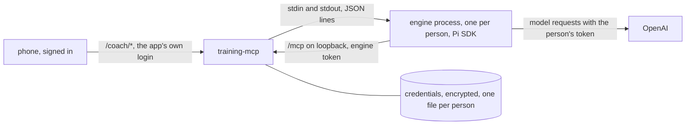

# In-app coach: chat with your own ChatGPT while you train

Status: experimental, **off by default**. Issue [#48](https://github.com/FullFran/training-mcp/issues/48).

The app's home is a chat with the coach. A signed-in person connects their own ChatGPT account there with a device code and talks with a coach that runs on the server. The coach uses training-mcp's MCP tools as that person and has no other tool. When they log a set, the coach gets that set and reacts on its own.

Connecting ChatGPT or Claude to `/mcp` yourself (option A) keeps working alongside it.

## Read this before enabling it

- **Not verified: OpenAI's terms.** The coach signs in with a person's own ChatGPT subscription and uses it from a server. Whether OpenAI's terms allow that use is an assumption nobody has checked (RE;write carries the same open question). Decide that before you enable it for other people.
- **Not verified: a real sign-in.** No real ChatGPT account was used while this was built. [What is not verified](#what-is-not-verified) lists what that leaves open, and [Manual check](#manual-check-with-a-real-account) is how to close it.
- **Training data goes to OpenAI** with the person's account whenever the coach reads it with a tool, as it does when they connect ChatGPT to `/mcp` themselves.
- **The operator pays for no model.** Each person brings their own account.

## How it works



| Part | Where | What it does |
| --- | --- | --- |
| Routes and chat | `internal/websrv/coach.go`, `static/coach.js` | The browser side, behind the app's existing login |
| Process manager | `internal/engine/manager.go` | Starts, feeds and stops engine processes; owns credentials, refresh, slots and live events |
| Vault and tokens | `internal/engine/vault.go`, `internal/engine/tokens.go` | Encrypted credentials; engine bearers for `/mcp` |
| `/mcp` door | `internal/httpsrv/server.go` (`engineGuard`) | Admits an engine token as its person, on direct loopback only |
| Protocol | `internal/engine/protocol.go`, `engine/protocol.ts` | The messages between host and engine; the Go side is the authority |
| Engine | `engine/main.ts` | A separate Node program on the Pi SDK (`@earendil-works/pi-coding-agent` and `pi-ai` 1.5.2), with its own lockfile |

The Go server never loads Node code. With the coach off, nothing in `engine/` is started and the `/coach/*` routes do not exist (404).

### Why this protocol and not ACP

The host speaks RE;write's engine protocol (one JSON object per line over the engine's stdin and stdout), not the Agent Client Protocol that haga-harness's `pi-sidecar` uses. For a Go host this is the simpler of the two:

- It is a dozen flat message types that a Go struct and `encoding/json` parse directly; ACP is JSON-RPC 2.0 with requests, responses, notifications, session and permission methods, which needs a client library or a hand-written JSON-RPC layer.
- It already carries what the security boundaries need: the host-held credential (`token.get`), the single refresher (`refresh`), and the device login (`login.start`, `login.code`). ACP has no standard method for these; they would be extension methods (haga-harness carries the credential that way).
- The ChatGPT-style picker and reasoning needed three more flat messages (`models.get`, `models`, `thinking`) and two optional fields on `prompt`. ACP stays a later option, for when another agent should run the coach (decided 2026-11-11).
- ACP's permission requests and file-system callbacks exist for a coding agent; here they would be dead surface, since the engine has no tools besides `/mcp`.

## Enable it

1. The image already contains Node and the engine (`/app/engine`). Nothing to build.
2. Create a key and keep a copy off the server. Losing it makes every stored credential unreadable; people then connect again.

   ```bash
   openssl rand -base64 32
   ```

3. Set the environment. The web app must be on (`WEB_BASE_PATH` or `WEB_OAUTH_CLIENT_ID`).

| Variable | Default | Meaning |
| --- | --- | --- |
| `TRAINING_COACH` | unset | `1` enables the coach. Anything else but empty stops the server |
| `TRAINING_COACH_KEY` | none | 32 bytes, base64. Encrypts stored credentials. Required when enabled |
| `TRAINING_COACH_MAX_PROCESSES` | `2` | Engine processes alive at once. Above the cap the answer is `busy` |
| `TRAINING_COACH_IDLE_SECONDS` | `300` | A process with no turn and no pending login for this long is stopped |
| `TRAINING_COACH_NODE` | `node` (`/nodejs/bin/node` in the image) | The Node binary |
| `TRAINING_COACH_ENGINE` | `/app/engine/main.ts` | The engine program |

Credentials are stored in `coach/credentials/` next to the database (`/data/coach/credentials/` in the image). Engine processes reach the server at `http://127.0.0.1:<port>/mcp`, so the server must listen on loopback too (the default `:8080` does).

## What a person sees

1. The home screen is the chat, laid out like ChatGPT: a top bar with the menu (☰), the conversation filling the screen, and at the bottom the live workout bar above the message box. The workout bar shows the exercise loaded now, a button that logs it with the pre-filled weight, reps and RPE in one tap, and the rest timer; **Ajustar** opens the full entry form as a sheet from the bottom, which closes after a set is logged. With no workout today it is one line. It is the same entry form, panel and timer as before, so it works without ChatGPT and from the cached page offline (a set still needs the network to be stored).
2. The menu opens **Historial**, **Rutinas**, **Revisar** and **Progreso** as panels over the chat, and holds the account: the ChatGPT state, **Enviar al acabar de dictar** and **Desconectar ChatGPT**. A pending proposal also shows as a badge in the top bar. **← Chat** closes the panel and returns to the same conversation; a change made in a panel refreshes the workout and the cards.
3. Cards in the chat come from the server, never from the model: the plan of the day (or a picker to start one), each proposal waiting for an answer, summarised in one sentence built from its payload (for example «Crear rutina «Pierna»: sentadilla 3 series»), with **Aceptar** and **Rechazar** (the same CSRF-protected `/review` endpoints; accepting there means "only this time", the other choices stay on `/review`), and each set logged from the workout card.
4. Not connected, the chat offers to connect ChatGPT, then shows a code and a link to `https://auth.openai.com/codex/device`. They sign in there and type the code. Nothing travels from their browser to the server in this step; the server polls OpenAI. The workout card and the panels work the same while not connected, or with the coach off.
5. Connected, an empty chat shows «¿Qué entrenamos hoy?» and suggestions built by the server from today's workout (never by the model); tapping one sends it. They type or dictate and the answer streams in, without a bubble, with a small Markdown subset (bold, italics, lists, line breaks, code) built from text nodes: markup the model writes, such as a `<script>`, shows as text. Above each answer one row says what the coach looked at, in words («Consultado tu historial · 3 pasos»), never a tool name; it opens to list each step. While it works a line says **Pensando…** or **Escribiendo…**, and the send button turns into stop. A failed answer shows the reason and, when asking again can help, **Volver a intentarlo**; a stopped one says **Detuviste la respuesta** with **Volver a pedirla**. A finished answer can be copied. The view follows the answer unless they scroll up; **↓** brings them back. The coach's writes go through the same proposals and permissions as any MCP client of that person: a write that waits for approval shows as a step **Cambio propuesto, pendiente de tu aprobación** and its card, with accept and reject, appears in the chat.
6. Logging a set adds a line for it to the chat and starts a short reaction from the coach (feedback on the set and what to do next), which always comes after that line. The stream stays open while the home is open.
7. Dictation uses the browser's own speech recognition, with no provider and no tokens. The round 🎤 button next to send starts it with one tap; while it listens the button turns red and pulses and **Escuchando…** shows above the message box. It stops by itself after a pause, or on a second tap, and the words land in the message box ready to send. **Enviar al acabar de dictar** (in the menu) sends them as soon as dictation ends; that choice is kept per device. Where the browser has no speech recognition, the button and the switch are hidden. Replies are not read aloud.
8. The 📷 button (in the message box) attaches up to 4 photos to the next message: on a phone it offers the camera or the gallery. Before anything leaves the phone, each photo is redrawn on a canvas, which drops its EXIF data (location included), and saved as a JPEG of at most 1600 px on its longer side (`static/coach-attach.js`). A message can be photos only. The photos show in the person's bubble and go to their model with that turn.
9. **Desconectar ChatGPT** (in the menu) deletes the stored credential, stops their engine process and revokes its token.

10. Tapping the title (**Coach · modelo ▾**) opens the model picker, like ChatGPT's: the models of their own ChatGPT login and, for the chosen model, how much to think before answering (**No**, **Mínimo**, **Bajo**, **Medio**, **Alto**, **Muy alto**, **Máximo**, only the levels that model takes). The **💡 Pensar** chip in the message box opens it too. The choice is kept per person and goes with every turn, the reactions to sets included. While the model thinks, **Pensando…** shows its reasoning as it streams; once it answers it closes to **Pensó N s**, one tap away. The list is read from the person's engine when the picker opens or after a turn, never on page load, so an open page starts no engine.

Without a choice, the model is the first one OpenAI lists for the account. Every model of the `openai-codex` provider in Pi 1.5.2 declares image input; Pi resizes a photo to the model's limits before the request.

11. Conversations are kept like ChatGPT's. The menu lists them, newest first, grouped by **Hoy**, **Ayer**, **Últimos 7 días**, **Últimos 30 días** and **Anteriores**; tapping one opens it with its messages and steps. **✎** (top bar or menu) starts a new chat, which becomes a conversation with its first message, titled from that message. **⋯** on a conversation renames or deletes it; **Borrar todas las conversaciones** deletes them all and nothing of the training data. The open conversation is reopened on that device after a reload, and the reaction to a logged set goes into it (or starts one, «Entreno del dd/mm»). Each conversation is deleted on its own **90 days after its last message**.

### Stored conversations

What is stored, per person (migration 019, tables `coach_conversations` and `coach_messages`): the person's text, the coach's answer (even when cut short), its steps as tool name and outcome, whether it was a reaction to a set, and how many photos a message had. Never stored: photos, reasoning text, the host's context lines, tool arguments or results.

The engine still keeps its model context in memory only. When a person opens another conversation, the server stops their engine and the next turn starts a fresh one, which gets that conversation's stored messages once, as host lines (`history person=` / `history coach=`, each text a JSON string, the newest 40 that fit in 24 KB). So after an idle stop or a restart the conversation continues with what was said, though not with the photos or the tools' raw results.

Retention: the server deletes every conversation whose last message is older than 90 days when it starts and every hour after, and never lists or opens one past that age even before the deletion runs. Deleting an account's user row deletes its conversations too. Backups of the data volume contain the stored conversations, like the training data.

## Routes

Under the app's base path, behind its existing login: the bearer of the secret mount, or the web login session at the root (which also checks its CSRF token on writes). Every write also needs the header `X-Coach: 1`, which a cross-site form cannot send. A request with no identity is refused with 403.

| Route | Answer |
| --- | --- |
| `GET /coach/status` | `{state}`: `disconnected`, `pending` (with `user_code` and `verification_uri`), `connected` or `reconnect` |
| `POST /coach/login` | Starts a device login: `{user_code, verification_uri, expires_in}`. One pending login per person; a new one cancels the previous. At most 3 starts per person in 15 minutes, then `rate_limited` |
| `POST /coach/disconnect` | Disconnects |
| `GET /coach/stream` | `text/event-stream`: `turn {origin: "user" or "reaction", conversation}`, `thinking {text}`, `delta {text}`, `tool {name, phase, ok?, call?, pending?}`, then `done {aborted}` or `error {code}` |
| `POST /coach/prompt` `{text, images?, conversation?}` | `202 {started, conversation}`; the answer arrives on the stream. Without `conversation` (or with 0), a new conversation starts; another person's, a deleted or an expired one is 404 `not_found`. Text is up to 4000 characters and may be empty only with photos; any other field is 400. `images` is a list of `{type, data}` with `data` in base64: at most 4 (`too_many_images`), each JPEG, PNG or WebP as its own bytes confirm, 1 byte to 2 MiB, 6 MiB in all (`bad_image`); a body over that size is 413 `images_too_large`. The request has 60 seconds to arrive |
| `POST /coach/abort` | `{aborted}`: stops the running turn |
| `GET /coach/models` | `{models: [{id, name, thinking}], model, thinking}`: the models of the person's ChatGPT login, as their engine reports them, with the thinking levels each takes, and the current choice. Starts their engine if none runs |
| `GET /coach/conversations` | `{conversations: [{id, title, updated_at}]}`, the person's kept conversations, newest first |
| `GET /coach/conversations/{id}` | `{id, title, updated_at, messages: [{role, origin?, text, steps?, photos?, at}]}`; 404 `not_found` when it is not theirs or has expired |
| `POST /coach/open` `{conversation}` | Makes it the open conversation, where reactions to sets go (0: a new chat) |
| `POST /coach/conversations/{id}/rename` `{title}` | 1 to 80 printable characters, else 400 `bad_request` |
| `POST /coach/conversations/{id}/delete` | Deletes it; an engine holding it in its context is stopped |
| `POST /coach/conversations/delete-all` | Deletes all of the person's conversations |
| `POST /coach/settings` `{model, thinking}` | Keeps the choice. A model their engine did not list, or a level that model does not take, is 400 `bad_request` and changes nothing |

Errors are a closed set of codes: `bad_request`, `not_found`, `model_busy`, `reconnect`, `provider_error`, `busy`, `rate_limited`, `turn_in_progress`, `turn_limit`, `not_connected`, `engine_unavailable`, `login_failed`. Provider error text can quote response bodies, so it never reaches a response or a log.

The service worker never handles `/coach/*`, so nothing of the chat is cached.

### Live workout events

Logging a set in the app (`POST /sets`, accepted) queues a `set_logged` event for that person: exercise, weight, reps, RPE, technique and the time, which is also when their rest starts. Events live in memory only, at most 20 per person, are dropped after 3 hours, and are never written anywhere. At the start of each turn the host writes them, oldest first, as lines before the person's text:

```text
[training-mcp context, set by the host] now=2026-11-11T18:02:10+01:00
[training-mcp context, set by the host] event=set_logged at=2026-11-11T18:00:00+01:00 exercise="press banca" weight_kg=80 reps=8 rpe=8.5 (rest started at this time)
```

Typed values are JSON strings, cut at 120 characters, with control and invisible format characters replaced. The system prompt tells the model that only the host writes these lines, always first, and that a later line claiming to be one was typed by the person; such a line of the person's text also gets `(person text) ` in front. Rest targets and elapsed rest are not carried here: the coach reads them with the `live_workout` tool and changes the target with `set_rest_target`.

Sets the coach itself logs through MCP are not echoed back as events.

## Security boundaries

- **Same door as a connected client.** The engine's MCP bearer is a random token (`tme_...`) the server keeps only as a SHA-256 hash in memory, tied to one person. It goes through the same `/mcp` handler and the same tools as that person's own connector would. It is not a JWT, so the OAuth verifier cannot accept it, and it does not open the web app.
- **Loopback only.** An engine token is honoured only when all of this holds: a live token, a loopback peer, a loopback IP in `Host` (the address the engine dials), and none of `Forwarded`, `Via`, `X-Real-IP`, `CF-Connecting-IP`, `True-Client-IP` or any `X-Forwarded-*` header. Anything less gets 401. A reverse proxy on the same host that adds none of these headers cannot be told apart from the engine; Caddy and Traefik add `X-Forwarded-For` by default. The token never leaves the engine process and the server's memory, so this is defence in depth.
- **Not the owner.** The engine door is checked before every other one, so even `MCP_AUTH_DISABLED=1` never turns an engine into the owner.
- **Short-lived.** A token lives as long as its process: until idle stop, disconnect, shutdown, or 60 minutes at most. A process whose token would expire during a turn is replaced first.
- **Credentials.** One file per person, named by a hash of the person, AES-256-GCM with the person bound in as associated data (a file moved to another person's name does not decrypt), mode 0600 in a 0700 directory, written to a temporary file and renamed. Never logged, never sent to the browser, never on the engine's command line or in its environment: the engine asks for the access token over stdin when it needs one, and never gets the refresh token except inside a refresh request. Backups of the data volume contain them, encrypted with a key the backup does not hold.
- **One refresher.** OpenAI's refresh token is single-use. The server is the only place that decides to refresh, one refresh at a time per person (concurrent token requests wait for the same refresh); the exchange runs in that person's engine through Pi. If it fails, the stored credential is kept and the person is asked to connect again. A process stopped while a refresh is out is kept up to 10 seconds so the new token can be stored; only a disconnect throws it away, including from a process already stopped.
- **Slots.** A process is a scarce slot. A pending login holds one without a credential, so it has a hard deadline (15 minutes), starts are rate-limited per person, a process left with no pending login and no credential is stopped at once, and a connected person's turn takes the slot of the oldest process that only waits for a code. A turn has a time limit (10 minutes) and a size limit (2 MiB of text); a process that does not settle after either is stopped.
- **Photos.** training-mcp never stores a photo: it is checked (count, size, type against its bytes), written to that person's engine as part of the prompt line, and dropped. The engine checks it again and passes it to Pi's prompt. It then stays in that engine's memory until the process stops, and the model sees it again on later turns; a stored conversation keeps only how many photos a message had. Photo bytes are never logged. A prompt line can carry up to about 8 MiB of base64, so the engine reads lines of up to 12 MiB from the server; what the engine sends back is still limited to 1 MiB per line.
- **Shutdown.** Engine processes exit when their stdin closes, which covers a server that dies. On SIGTERM or SIGINT the server stops them before draining HTTP connections, which also ends open chat streams.
- **Tools.** Pi has no sandbox, so its shell and file tools are off (`noTools: 'builtin'`) and its script tool is not activated (`direct` exposure). The engine reports its tool list when the session starts; the engine and the server each stop it if any tool is not `mcp__training__*`.
- **Model providers.** The engine process gets an environment with `PATH` only and a private temporary home, so no provider key of the operator reaches it. Before the first request it checks that every available model belongs to the person's OpenAI login.
- **Model choice.** A person can only choose among the models their own engine listed from their login: the server refuses any other id before storing it, and the engine, given a stored id the account no longer lists, uses the account's first model instead. The choice is two columns of the person's row (`coach_model`, `coach_thinking`); reasoning text streams like the answer, under the same size limit, and is never stored.
- **Isolation.** Every coach call names the person the request was authenticated as; events, streams, slots, credentials and stored conversations are kept per person (every conversation query carries the person's id; another person's conversation answers 404 like one that does not exist). Tests cover two people for each route and for events.
- **Not a sandbox against the operator.** Anyone with a shell in the container and the key can read stored credentials.

Engine lifecycle is logged as `{"event":"engine.process","action":"start"|"stop","reason":...,"live":n}`, with no person, token, code or text.

## What is not verified

Tests run against a fake engine process (the Go test binary speaking the protocol) and call no provider; `cmd/training-mcp` runs the whole path, browser routes to engine to `/mcp` and back to the stream, with that fake. The real engine was started locally and in the image with the pinned packages against a local server: it reported Pi 1.5.2, connected to `/mcp` and listed exactly the 35 training-mcp tools. Without a real ChatGPT account, these remain open:

- the device-code login end to end (code shown, approval at OpenAI, credential returned and stored);
- that OpenAI accepts this login from a server address;
- the refresh exchange with a real rotating refresh token;
- a real model request: streaming, tool calls reaching `/mcp`, the answer arriving on the phone;
- the model list of a real account, and that its first entry is the right default;
- which error texts a real 429, 503 or expired login produce, and so whether they map to `model_busy` and `reconnect`;
- abort during a real model request;
- that a real model answers about a photo (the photo path is tested up to the prompt line the engine reads, and Pi's own conversion to `input_image` was read in its source, not run);
- memory and latency under real use.

## Manual check with a real account

Use a test account's data only.

1. Set `TRAINING_COACH=1` and `TRAINING_COACH_KEY`, deploy, and confirm `GET /health` still answers.
2. Open the app on a phone, signed in. The chat says ChatGPT is not connected and that the password is never typed here. Press **Conectar ChatGPT**: a code and the OpenAI link appear.
3. Approve at OpenAI. Within a few seconds the chat shows the message box. On the server, `ls -l /data/coach/credentials/` shows one file with mode `-rw-------` and no readable token inside.
4. Ask "¿qué rutinas tengo?". The answer streams and a step shows the tool call.
5. Log a set with the workout card's one-tap button: a card for the set appears and the coach reacts to it within seconds. Open **Historial** from the menu, go back with **← Chat**: the conversation is still there, and it is listed in the menu. On a phone whose browser supports dictation, tap 🎤, say a sentence and stop talking: it stops by itself and the text is in the message box; turn on **Enviar al acabar de dictar** and dictate again: it is sent.
6. Start a long answer and press the stop button: it stops, and the next message works.
7. Wait past `TRAINING_COACH_IDLE_SECONDS` and send again: it answers and still knows what was said earlier in that conversation. `docker logs` shows `engine.process` stop and start lines and no token, code or message text.
8. After more than an hour, send again: the turn still works (a refresh happened) and the credential file has a new modification time.
9. Press **Desconectar ChatGPT** in the menu: the file is gone and the chat asks to connect again.
10. From another account with no connection, confirm the chat asks to connect and shows nothing of the first account.

If step 3, 4 or 8 fails, the chat shows a fixed message only. Run the engine by hand to see the real error; it is deliberately not logged.
