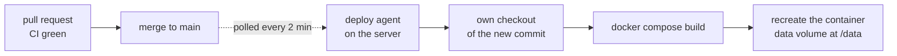

# Deployment

Production runs one container of this repository's `Dockerfile`, served at
`https://training.fullfran.com`. Nothing in this repository deploys it: a deploy
agent on the server, defined in the infra repository, pulls `main` and builds
it there. Merging to `main` is therefore a deploy, a few minutes later.

## How a commit reaches production

1. A systemd timer runs the deploy agent every two minutes. It fetches `main`
   over a read-only deploy key and compares its head with the last commit it
   deployed. GitHub holds no credentials for the server; nothing pushes to it.
2. On a new commit it checks that commit out into its own checkout, with
   `git reset --hard` and `git clean -fdx`. The agent runs with umask `0077`,
   so every file in that checkout is readable by its owner only, and `COPY`
   keeps those modes in the image.
3. It runs `docker compose build` from that checkout, then `up -d`. The
   strategy is `recreate`: the old container stops before the new one starts,
   so the service is down for a few seconds on each deploy.
4. The container mounts a named Docker volume at `/data`, where the SQLite
   database lives (`TRAINING_DB_PATH=/data/training.db`). The volume is
   external to the compose project and survives every recreation.
5. The agent records the commit only after build and start both succeed. A
   failure is retried on the next run and mailed to the owner once it has
   lasted about ten minutes.

Runtime configuration (`MCP_BEARER_TOKEN`, the `MCP_OAUTH_*` and
`WEB_OAUTH_*` settings) comes from an encrypted environment file in the infra repository.
This repository holds no deployment secrets.

## CI must be green before merging

The server builds the image for the first time after the merge, so anything
CI does not catch is caught in production. The `CI` workflow runs on every
pull request and on every push to `main`:

- `test`: green only when every `go test (<shard>)` job passed. The
  race-enabled suite is split by package across three runners: `mcpsrv`,
  `web` (`websrv` and `engine`) and `rest` (every other package, so a new one
  is covered without editing the workflow). The `rest` shard also runs
  `gofmt`, `go vet` and the coverage floor for the store.
- `image`: strips group and other permissions from the checkout
  (`chmod -R go-rwx .`) to reproduce the server's umask, builds the image,
  boots it with a throwaway bearer token and no volume, waits up to 30 s for
  `GET /health` to answer `{"status":"ok"}`, checks that `/mcp` refuses a
  request without a token, and checks that `/data/training.db` was created as
  a SQLite file. It then runs the coach engine in the image (Node and the Pi
  SDK must load and report Pi 1.5.2) and boots a second container with
  `TRAINING_COACH=1` and a throwaway key, which must answer `/app/coach/status`
  behind the token and refuse it without. No login is started: that would call
  OpenAI. A failure prints the containers' logs.

Merge only when both jobs are green. The branch is not protected, so this is
a rule to follow, not one GitHub enforces.

## What is deployed

The application does not report its own version: `/health` only says that it
is up. The deployed commit is the one the deploy agent last recorded, and the
agent logs every deploy with its commit. Read both on the server as described
in the infra repository. When the agent is healthy, the deployed commit is the
head of `main` within a few minutes of a merge.

## Rolling back

- **Revert on `main`** (the normal path): `git revert` the bad commit in a pull
  request, let CI pass, merge. The agent deploys the revert like any other
  commit.
- **From the infra side**: the agent deploys the head of `main`. Its `--force`
  option redeploys the current head even when it is unchanged; it does not take
  an older commit. Deploying an older commit without changing `main` is a
  manual operation on the server, covered by the infra repository.

A rollback replaces the code, not the data. The volume keeps whatever the
newer version wrote, and migrations only move forward. Before rolling back past
a commit that added a migration in `internal/sqlitestore`, check that the older
code still works against the newer schema, and take a backup first (see the backup notes under
[Web UI (PWA)](../README.md#web-ui-pwa) in the README).
