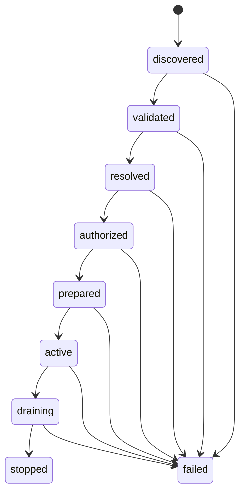

# HCS-0004 Lifecycle

| Field | Value |
| --- | --- |
| Status | Draft |
| Version | 0.1.0-draft |
| Requires | HCS-0001, HCS-0003, HCS-0005, HCS-0006 |
| Replaces | none |
| Schema | `schemas/hcs-0004/lifecycle/v0.1/lifecycle.schema.json` (`urn:hcs:schema:hcs-0004:lifecycle:0.1`) |

## 1. Scope

The lifecycle is the per-entry state machine a host runs from reading a catalog to stopping a package, and the rule for moving from one desired set to the next. MCP tasks are per-call jobs on a server and do not cover it ([docs/standards/mcp.md](https://github.com/FullFran/hcs/blob/v0.1.0-draft.10/docs/standards/mcp.md)); Cordis "reversible effects" are the closest precedent ([standards-catalog.md](https://github.com/FullFran/hcs/blob/v0.1.0-draft.10/docs/research/standards-catalog.md), precedents). This document fixes state names and the few transition rules every host needs; it does not define deadlines, retries or how a plugin is started.

## 2. States

| State | Entered when | Package code has run? |
| --- | --- | --- |
| `discovered` | the entry was read from a catalog | no |
| `validated` | document checks (HCS-0001 4.1) passed | no |
| `resolved` | resolution (HCS-0003) placed it in the activation order | no |
| `authorized` | the host decided its grants (HCS-0005) | no |
| `prepared` | bytes were fetched, verified (HCS-0001-R007) and unpacked | no |
| `active` | its contributions are registered and callable | yes |
| `draining` | it is being taken out of service; no new calls are dispatched to it | yes |
| `stopped` | it was taken out of service cleanly | yes |
| `failed` | a step failed; the entry carries an HCS-0006 error | maybe |

## 3. Requirements

**[HCS-0004-R001]** A host MUST NOT run code from a package before its entry reaches `prepared`.

**[HCS-0004-R002]** A host that reports entry state MUST use the state names in section 2 and the HCS-0004 status schema.

**[HCS-0004-R003]** When a host moves from one desired set to another and any entry selected for activation fails to reach `active`, the host MUST return every entry to the state it had before the transition began.

**[HCS-0004-R004]** A host MUST stop entries in the reverse of their activation order.

**[HCS-0004-R005]** A host MUST report `unsupported_capability` for a call to a capability whose providing entry is not `active`.

**[HCS-0004-R006]** A host MUST NOT dispatch new calls to an entry in `draining`.

**[HCS-0004-R007]** A host that abandons a lifecycle step because it exceeded the host's deadline MUST move the entry to `failed` with code `timeout`.

R003 is the atomicity rule: from the caller's view a desired-set change either happens or does not. Which entries are "selected for activation" follows the host's declared activation policy (HCS-0003 section 3, step 6).

## 4. Telemetry

A host that emits telemetry for lifecycle transitions SHOULD use OpenTelemetry and the attribute names in [docs/standards/opentelemetry-genai.md](https://github.com/FullFran/hcs/blob/v0.1.0-draft.10/docs/standards/opentelemetry-genai.md) for tool and agent calls; HCS 0.1 defines no lifecycle event names of its own (OQ-0004-3).

## 5. Open questions

- OQ-0004-1: deadlines per step and whether the catalog can suggest them.
- OQ-0004-2: drain semantics (wait for in-flight calls, cancel them, or a deadline then cancel). MCP 2026-07-28 has no resumable streams, so cancellation loses in-flight work.
- OQ-0004-3: lifecycle event names and whether they are CloudEvents types ([docs/standards/cloudevents.md](https://github.com/FullFran/hcs/blob/v0.1.0-draft.10/docs/standards/cloudevents.md)).
- OQ-0004-4: persistence of per-entry state across host restarts. Which generation a host starts and what it remembers about failed ones is closed by HCS-0008 section 7.1 (R031 to R035).
- OQ-0004-5: a `failed` entry's recovery path (retry versus a new desired set).
- OQ-0004-6: out-of-band modification of a prepared or active entry's content (someone edited installed files). The first host detects it and stops reconciling until an operator intervenes; whether HCS defines the condition, its error code, and the host's duty, is open ([ADR-0014](https://github.com/FullFran/hcs/blob/v0.1.0-draft.10/docs/adr/0014-profile-error-codes-join-the-core-registry.md)).
